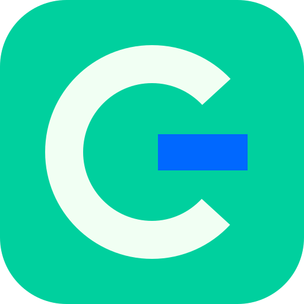

<div align="center">
  

  <h1>finWise</h1>

  <p><strong>Catat uang dengan lebih jelas. Rencanakan langkah berikutnya dengan percaya diri.</strong></p>

  <p>Aplikasi keuangan pribadi untuk mencatat transaksi, memahami arus uang, dan memantau target simpanan.</p>

  
  
  
  
  

  <br>
  <sub>Antarmuka tersedia dalam Bahasa Indonesia, English, dan 日本語</sub>
  <br><br>
  <a href="#yang-bisa-kamu-lakukan">Fitur</a> ·
  <a href="#mulai-dalam-beberapa-langkah">Instalasi</a> ·
  <a href="#perintah-yang-sering-dipakai">Perintah</a> ·
  <a href="#menjalankan-di-produksi">Produksi</a>
</div>

---

## Tentang finWise

finWise membantu mengelola keuangan harian dalam satu tempat. Catat pemasukan, pengeluaran, dan transfer; lihat ringkasan saldo; lalu gunakan analisis, anggaran, dan target simpanan untuk memahami kebiasaan finansial.

Dibangun dengan **Laravel 13**, **Livewire 4**, **Blade**, **Tailwind CSS 4**, dan **Vite Plus**.

## Yang bisa kamu lakukan

|  | Fitur | Detail |
|---|---|---|
| 💸 | **Catat transaksi** | Pemasukan, pengeluaran, dan transfer antarakun dengan pencarian serta filter riwayat. |
| 📊 | **Pahami arus uang** | Grafik tren batang/garis atau komposisi kategori donat. Pilih gaya grafik di Profil; grafik mengikuti periode dan filter kategori. |
| 🎯 | **Atur rencana** | Kelola anggaran kategori dan pantau target simpanan. |
| 🗂️ | **Pulihkan data** | Item yang dihapus masuk trash dan dapat dipulihkan selama tiga hari. |
| 💬 | **Tetap terhubung** | Chat pribadi dan grup, stiker, foto, posisi baca, retensi pesan, serta panggilan suara WebRTC. |
| 📲 | **Lanjutkan saat offline** | Baca snapshot terakhir dan catat transaksi baru di perangkat untuk disinkronkan kemudian. |
| 🔔 | **Terima notifikasi** | Notifikasi aplikasi dan Web Push untuk aktivitas finansial. Push tidak memuat isi chat atau nominal sensitif. |
| 🎨 | **Atur tampilanmu** | Tema terang/gelap, aksen, font, ukuran teks, pola, gaya grafik, dan bahasa Indonesia, Inggris, atau Jepang. |

> **Privasi:** data keuangan dibatasi per pengguna. Foto chat disimpan privat dan hanya dapat diakses oleh peserta percakapan.

## Mulai dalam beberapa langkah

### Kebutuhan

- PHP **8.3+** dengan ekstensi PDO SQLite, OpenSSL, cURL, dan mbstring
- Composer
- Node.js dan npm
- SQLite

### Instalasi

1. Pasang dependensi backend:

   ```sh
   composer install
   ```

2. Buat `.env` dan database SQLite jika belum tersedia.

   Jika salah satu berkas sudah ada, lewati perintah pembuatannya agar konfigurasi atau data lokal tidak tertimpa.

   **Windows PowerShell**

   ```powershell
   Copy-Item .env.example .env
   New-Item -ItemType File -Path database/database.sqlite
   ```

   **macOS / Linux**

   ```sh
   cp .env.example .env
   touch database/database.sqlite
   ```

3. Siapkan aplikasi dan aset:

   ```sh
   php artisan key:generate
   npm install
   php artisan migrate
   ```

4. Jalankan server dan frontend dalam dua terminal:

   ```sh
   php artisan serve
   ```

   ```sh
   npm run dev
   ```

   Atau jalankan seluruh layanan pengembangan sekaligus dengan `composer dev`.

5. Buka alamat yang ditampilkan Artisan, biasanya <http://127.0.0.1:8000>, lalu buat akun.

### Data demo

Jalankan `php artisan db:seed` untuk membuat pengguna lokal `test@example.com` (kata sandi `password`), kategori bawaan, dan akun Dompet. Kredensial ini hanya untuk pengembangan lokal.

## Perintah yang sering dipakai

| Perintah | Kegunaan |
|---|---|
| `composer dev` | Menjalankan server, queue listener, log viewer, dan Vite Plus. |
| `composer test` | Pemeriksaan Pint, PHPStan, dan tes aplikasi. |
| `php artisan test` | Menjalankan tes Pest/PHPUnit. |
| `composer lint:check` | Memeriksa format PHP tanpa mengubah file. |
| `composer types:check` | Menjalankan analisis statis PHPStan. |
| `npm run dev` | Menjalankan Vite Plus untuk pengembangan frontend. |
| `npm run build` | Membangun aset frontend untuk produksi. |

## Menjalankan di produksi

### Build dan migrasi

```sh
npm run build
php artisan migrate --force
```

Gunakan HTTPS untuk fitur browser seperti Web Push dan mikrofon panggilan suara.

### Web Push

Buat pasangan kunci VAPID:

```sh
php artisan webpush:generate-keys
```

Simpan nilai `PUSH_VAPID_PUBLIC_KEY`, `PUSH_VAPID_PRIVATE_KEY`, dan `PUSH_VAPID_SUBJECT` pada `.env`. Jaga private key tetap rahasia. Pengguna mengaktifkan notifikasi melalui browser. Di iPhone/iPad, pasang PWA ke Home Screen; Web Push memerlukan iOS/iPadOS 16.4 atau lebih baru.

### Mode maintenance

Mode maintenance aplikasi dapat dikendalikan dari `.env`; middleware membaca berkas tersebut pada setiap request, termasuk saat konfigurasi Laravel dicache.

```dotenv
APP_MAINTENANCE=true
APP_MAINTENANCE_MESSAGE=
APP_MAINTENANCE_RETRY=60
```

Gunakan `APP_MAINTENANCE=false` untuk membuka aplikasi kembali. Pesan kosong memakai teks terjemahan bawaan. Mode maintenance Artisan juga didukung:

```sh
php artisan down --render=errors::maintenance --retry=60
php artisan up
```

## Catatan penggunaan

- Nominal disimpan sebagai integer Rupiah; tanggal transaksi menggunakan tanggal kalender.
- Snapshot offline memuat maksimal 200 transaksi terakhir. Transaksi offline disimpan dalam antrean lokal dan dikirim saat koneksi pulih. Jangan hapus data browser sebelum sinkronisasi selesai.
- Chat suara memakai WebRTC peer-to-peer tanpa relay media bawaan. Koneksi dapat gagal pada jaringan yang memerlukan TURN.
- Foto profil disimpan sebagai WebP 1024 × 1024 dengan batas ukuran 1,5 MB. Berkas unggahan lokal berada di `public/profile-photos/`.
- Preferensi tampilan disimpan di browser; pilihan bahasa disimpan di sesi.

<details>
  <summary><strong>Status batas anggaran</strong></summary>

  Batas bulanan dan alokasi kategori saat ini berfungsi sebagai ringkasan serta pemicu notifikasi. Transaksi yang melewati batas masih dapat disimpan, termasuk ketika transaksi offline disinkronkan.
</details>

## Struktur proyek

```text
app/                 Logika aplikasi, Livewire, model, dan layanan
routes/              Route web dan perintah Artisan
database/            Migrasi, seeder, dan factory
resources/views/     Tampilan Blade
resources/css/       CSS sumber
resources/js/        JavaScript aplikasi
lang/{id,en,ja}/     Terjemahan UI dan validasi
public/              Aset publik, ikon, PWA, dan mode offline
tests/               Tes Feature dan Unit
```

## Lisensi

Proyek ini menggunakan lisensi MIT.
